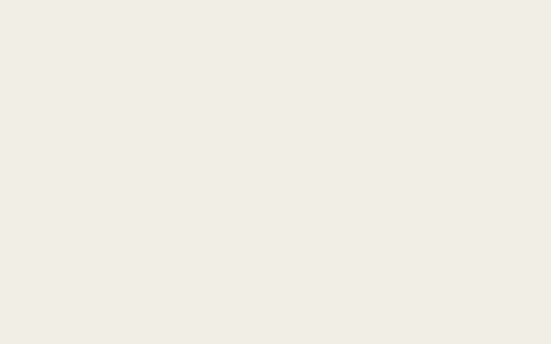

# Reticle

**Images that are circuits.** Draw a logo, icon, favicon, badge or artwork, or write it as a formula. Reticle compiles it to NAND gates and tapes it out on X Layer. Any website can then show it straight from the chain, with no wallet and no gas for the viewer.



The picture can't be pre-rendered, because the chain's own gates are what draw it.

Works in any page today; built for DeWEB sites.

## Use an image on your site

```html
<script src="https://reticle-woad.vercel.app/reticle-embed.js" defer></script>

```

`reticle-embed.js` is under 4 KB (3.9 KB minified), has no dependencies and needs no wallet, key or backend. It reads the circuit over public X Layer RPCs (three, in order, with backoff on 429 and 5xx, six requests at a time, rows cached in sessionStorage), asks `ReticleRenderer.svg()` for the picture when the gas fits and falls back to one `eval` per row when it does not. `data-verify` adds a tooltip with the block it rendered at. See the `/embed` page for a live example.

## What is on chain

| | |
|---|---|
| Chain | X Layer mainnet (196) |
| Processor, circuits (ERC-721) | `0x9FcbE4974C761d361d36CEE6734e381843a072BC` |
| Transistors (ERC-1155) | `0x9d9Bb3CEC5fe8654D7b089C0dD03bcAeCF4F6045` |
| ReticleRenderer | `0x807df960078e4e8b3079ef04879b05a8852a197a` |
| Deployer | `0x7945ffB152e7c6CE8f479F5A24874C57A8B9e19D` |
| Supply cap | 1,048,576 transistors, immutable |
| Price | 0.00003 OKB per transistor |
| Burn | one transistor per gate at tapeout |

The story written into the deploy call:

> Reticle: images that are circuits. Every image is a NAND circuit and renders from its own eval, wallet-free and gas-free for viewers. Ink = transistors. Supply cap 1,048,576 (shared NAND/LATCH), price 0.00003 OKB each, no other cap, immutable at deploy. One transistor burns per gate at tapeout. Mint proceeds go to the creator via owed()/withdraw(). Built on TapeOut upgradeable beacon contracts, unaudited.

Nine seed circuits are taped out: five formula presets, one animated formula, and a crosshair logo, an R mark and a NAND badge. The full table with transaction links is in [STATUS.md](STATUS.md) and on the Proof page.

An earlier renderer at `0xc69c3b7863cc1c7406a5335d68577dc37ca7dd5d` is superseded. Its `svg()` appended to a string in a loop, which grows memory cost quadratically and ran past the 50M gas an `eth_call` gets by default. The current one writes into a single buffer and returns a 32×32 piece in about 11M gas.

## How it works

1. **Draw, upload or type.** An 8, 16 or 32 pixel square with up to 8 frames. A formula is written in `x`, `y`, `t`. An uploaded image is downscaled in your browser, thresholded to one bit and dropped into the grid. Nothing is sent anywhere.
2. **Compile.** Each output column is minimized (Quine-McCluskey, greedy cover) and mapped to 2-input NAND gates with structural hashing, so shared terms cost nothing. The compiler shows gates per pixel and the ratio against a naive netlist.
3. **Tape out.** `mint` ink, then `tapeout(bytes, nIn, nOut)`. The circuit is the NFT.
4. **Read it back.** One `eval(row y, frame t)` returns a row. 32 evals draw a 32×32 image.

## Verify it in two minutes

| Step | Where | Expect |
|---|---|---|
| Open the gallery with no wallet | `/gallery` | 10 thumbnails paint in row by row, about 4 s for a 32×32 piece |
| Open a piece and press **Verify on-chain** | `/piece/7` | check mark, and the line says which path ran |
| Open `/embed` | `/embed` | the example image loads from chain, hover shows the block |
| Open `/proof` | `/proof` | processor params read live, 9/9 pieces pixel-exact |
| Run it yourself | `pnpm verify` | 9/9 pass, about 30 s |

Measured on mainnet: a tapeout confirms in about 6 s, and the browser flow from click to a verified picture took 18 s (mint, tapeout and a full read back).

## Run it locally

```bash
pnpm install
pnpm test                 # compiler, chain helpers, embed, web
cd contracts && forge install foundry-rs/forge-std --no-git && forge test
pnpm build                # sync evidence, build embed, build web into web/dist
pnpm -F web dev
```

Scripts live in `scripts/`. Everything that spends reads fees from the chain right before sending.

| Command | Does |
|---|---|
| `pnpm phase0` | read-only probes, checks the simulator against live circuits |
| `tsx scripts/tapeout.ts <design>` | compile, mint, tape out, read back, record evidence |
| `pnpm verify` | re-render every circuit through eval and the renderer, tamper test |
| `pnpm bench` | gate counts against the naive baseline |
| `pnpm check:facts` | fails if docs or code disagree with `submission-facts.json` |

## Layout

```
packages/compile   bitmap or formula to NAND netlist, bit-exact simulator
packages/chain     ABIs, constants, render helpers shared by scripts and web
contracts          ReticleRenderer.sol, unit and fork tests (Foundry)
web                Vite, React, viem. Static site, no backend
scripts            deploy, tapeout, verify, bench, capture
designs            the nine seed designs as committed bitmaps
evidence           machine-readable results every number on the site comes from
```

## Limits

Unaudited. The TapeOut contracts are upgradeable beacons that Reticle does not control. Images are 1-bit squares. See [THREATS.md](THREATS.md) and [ISSUANCE.md](ISSUANCE.md).

MIT licensed.
